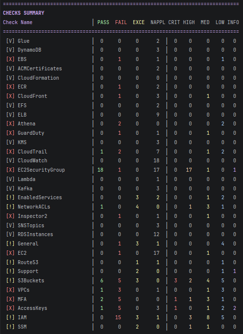
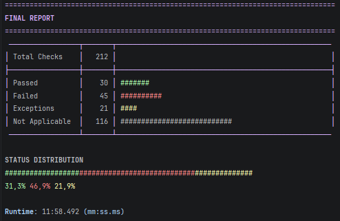
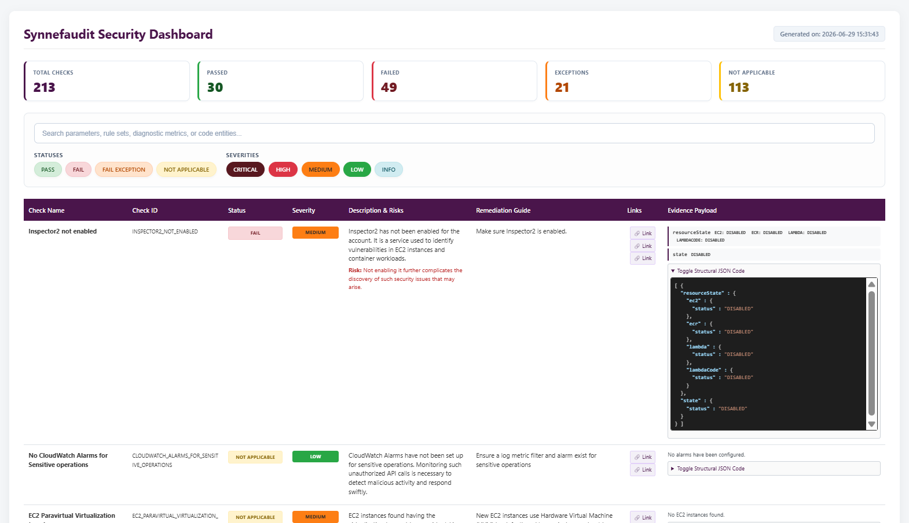

# What's the project about?

This is a cli tool that can be used to perform audits on AWS infrastructure.
After running, a detailed report is generated based on different metrics and requirements which includes the response data for each item, issue descriptions, recommendations and links to official resources that expand on what is mentioned and offer additional assistance.

# How to use

The AWS permissions required for the user are: SecurityAudit, ViewOnlyAccess

Install the AWS CLI, provided by Amazon: https://docs.aws.amazon.com/cli/latest/userguide/getting-started-install.html

Retrieve the key id and secret from the AWS Console generated for cli access, and configure the AWS CLI manually, or through `aws configure`.

The related files on `/.aws` in the user's home directory should resemble the following (though it may vary depending on how the user and its permissions are set up on AWS):

`.aws/config`:
```
[default]
region = {YOUR_REGION}
output = json
[profile pentester]
role_arn = arn:aws:iam::{CHANGE_WITH_ROLE_ID}:role/{CHANGE_WITH_ROLE_NAME}
source_profile = default
mfa_serial = arn:aws:iam::{CHANGE_WITH_YOUR_ID}:mfa/{CHANGE_WITH_YOUR_LOGIN_NAME}
```
`.aws/credentials`:
```
[default]
aws_access_key_id = {YOUR_KEY_ID}
aws_secret_access_key = {YOUR_ACCESS_KEY}
```

> For ease of use of the AWS CLI in general, the environment variables `AWS_PROFILE` and `AWS_REGION` can be set accordingly, but this is not required.

In order to test everything is set up correctly, you may run a command such as:
```
aws s3 ls
```

Call the program using the following parameters:
```
--region {region} --profile {profile} --outdir {absolute-path-to-output-directory}
```

If there is already a JSON output you want to use to create an HTML file, run:
```
--from-json {absolute-path-to-json-file}
```

You may also use `--help` for more options.

# Output

The tool generates 3 files: 1 detailed JSON file that includes the output received for each item, 1 JSON summary and 1 detailed HTML

Example console output:





Example HTML file output:

